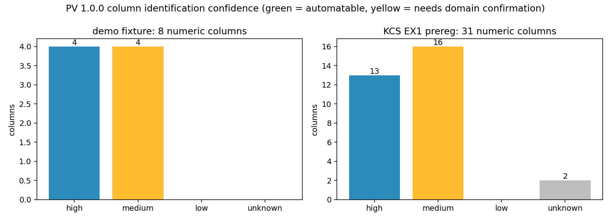
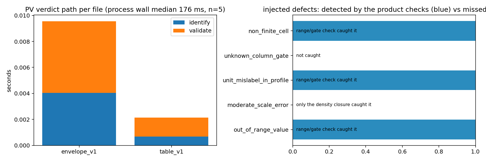

# PROD-PV 产品化交付：Physics Dataset Validator 1.0.0

**任务** m22924 · 仓 TensorData · 分支 `agent/m22924` · 基线 = 远端 `main` @ `0ad0a25`
**产品身份** `physics-dataset-validator 1.0.0`（report schema 0.1.0）
**上游证据** 试点 PR #10（m22061，`1855903`）+ 独立审查 PR #11（m22510，verdict 908 pass，`scenario_validated=true`）

本单不加任何新的检查语义：把已验证的试点转成**可交付产品**——补版本号、CHANGELOG、上手文档、一条真实跑通的 demo 命令，并给出六维商业价值证据（全部实测，缺的如实标 gap）。

---

## ① 案例介绍（物理背景 / 输入 / 参数）

被验收对象是 KCS（KRISO Container Ship）预注册数据包 EX1 的两张真实场表，与试点同一输入（内部授权 `internal_consent`，本报告只登记指纹，不转载内容）：

| 文件 | 行数 | 数值列 | 形态 | 关键参数 |
|---|---|---|---|---|
| `envelope_v1.csv` | 117 | 12 | 13 变体 × Fn 网格（`variant` 列重复，属 variant-major 导出） | Lpp=230 m, B=32.2 m, T=10.8 m, Cb=0.6509, S=9424 m², ρ=1025 kg/m³ |
| `table_v1.csv` | 9 | 17 | 单变体 Fn 网格 | 同上 |

输入指纹（SHA-256，由本次运行重新计算，与试点钉扎值一致）：`envelope_v1.csv` = `c6b14731a80de108253ed50f89d644068fb188276fe8f09351bfb6f060d8bfcd`，`table_v1.csv` = `9126738f02fb1fd69f07921173f59f71476e54eaaafc1c9f73a3204bdbb6ab56`。
自带 demo 输入 `examples/pv-demo/demo-resistance.csv` 是**合成**演示件（`Fn=0.15…0.30`，6 行 8 列，按 `Rt=½ρCtSV²` 自洽生成），只为让第三方零私有数据跑通 demo，不作任何证据。

## ② 怎么做的（方法与关键设置）

### 2.1 动手前对账（开工三律①）

- `git fetch origin && git log --oneline -8 origin/main` → 基线 `0ad0a25`；本仓近期合并：PR #11（m22510 独立审查文档）、PR #10（m22061 试点 + `quality/fields.py`）、PR #9（`feat/physics-unit-normalization`）、PR #8（`feat/physics-csv-validator`）、PR #7（`foundation/physics-dataset-validator`）。
- 未发现本单范围内他人已交付的产品面（版本号在 `physics_csv.py` 里是硬编码字面量、无 CHANGELOG、无 demo 命令、无上手文档）。

### 2.2 已有实现清单（开工三律②：禁重复实现，只补缺口）

| 已有能力 | 位置 | 来源 | 本单是否重做 |
|---|---|---|---|
| 质量引擎（流式度量 + 规则崩溃隔离） | `tensordata/quality/engine.py`, `rules/` | PR #1 质量引擎 | 否 |
| 物理 CSV 适配器（finite / units / bounds / axis / rights） | `tensordata/quality/physics_csv.py` | PR #8 | 否 |
| SI 单位注册表（`_kN` vs `_kn` 大小写敏感） | `tensordata/quality/units.py` | PR #9 | 否 |
| 列字段/单位自动识别 + 未知率闸门 + 分组轴检查 | `tensordata/quality/fields.py` | PR #10 (m22061) | 否 |
| 场景验收试点（11 判据 + 4 负向注入 + 证据清单） | `scripts/pv_pilot_ex1_kcs.py`, `docs/pilots/PV-EX1-KCS-STAGE3-PILOT.md` | PR #10 | 否（只复用其输入与结论） |
| 独立审查回执 | `docs/reviews/m22061-PV-REVIEW.md` | PR #11 (m22510) | 否 |

**本单增量（缺口 = 产品面，共 6 个文件 + 2 个生成物）**：

| 新增/修改 | 作用 |
|---|---|
| `tensordata/quality/version.py`（新） | 产品身份单一真源：`PRODUCT_ID/PRODUCT_VERSION/REPORT_SCHEMA_VERSION` + 语义化版本规则 |
| `tensordata/quality/physics_csv.py`（改 5 行） | 报告里的 `product_id/product_version/schema_version` 由硬编码字面量改为从 `version.py` 取（版本号原来散落在报告体里，无法单点发布） |
| `tensordata/quality/__init__.py`（改） | 导出产品身份 |
| `scripts/pv_demo.py`（新） | 一条命令的产品级 demo/CLI：逐文件裁定 + 识别覆盖 + 复核负荷 + 基线对照 + 5 例注入 + wall clock + `result_digest` |
| `scripts/pv_product_metrics.py`（新） | 六维里"时长/复现/成本"的实测采集器（进程级 wall/CPU + 平台账本查询 + 确定性判定） |
| `docs/CHANGELOG.md`（新）、`docs/validators/PHYSICS_VALIDATOR_QUICKSTART.md`（新）、`examples/pv-demo/`（新） | 发布记录 / 第三方上手文档 / 可跑 demo 输入 |
| `tests/test_pv_product.py`（新，6 项） | 锁死：版本单一真源、CHANGELOG 与版本一致、demo 通过 + 两次运行 digest 相同、注入灵敏度、未知率闸门是比率而非逐列规则 |
| `docs/m22924/`（本报告 + 证据 JSON + 生成表 + 2 图） | 交付物落 `docs/m<id>/`（不落 runs/artifacts） |

### 2.3 实验设计（预注册，先定判据再看结果）

- **决策**：PV 1.0.0 是否可以按"可交付产品"发布（有版本、有文档、有一键 demo、六维可查）。
- **对照臂**：① 前方案 = 大小写不敏感的 `_suffix` 查表（任何人第一版都会这么写，`normalize_unit` 会把 `_kn` 折成 `kn` 力单位）；② 手工基线 = 试点前必须手写完整 profile（每变量 unit + range）。
- **指标**：识别覆盖/复核负荷（自动化率）、两臂裁定差异（质量对照）、注入检出（5 例）、端到端 wall/CPU（时长与成本）、`result_digest` 跨进程一致性（复现）。
- **阈值**：`unknown_rate` 硬闸 10%（既有）；复现判据 = 连续 5 次独立进程 `result_digest` 完全相同；时长不做门槛（只报中位数与极值）。
- **环境**：Python 3.11.6，run 时本机；两臂同进程同输入同 profile 生成器，唯一变量是单位解析策略。

## ③ 计算结果（全部由脚本程序化产出，零手抄）

### 3.1 真实输入（KCS EX1）裁定

<!-- generated by scripts/pv_demo.py from artifacts/pv-demo/docs-kcs; do not edit -->
Product: `physics-dataset-validator 1.0.0`

### Per-file verdict and identification

| file | rows | numeric cols | identified | unknown | verdict | baseline verdict |
|---|---|---|---|---|---|---|
| `envelope_v1.csv` | 117 | 12 | 12 | 0 | **passed** | failed |
| `table_v1.csv` | 9 | 17 | 17 | 0 | **passed** | failed |

### Physics closures (independent of the profile)

| file | implied density kg/m3 | relative spread | Pe=Rt*V max rel dev | V_kn vs V_ms max rel dev |
|---|---|---|---|---|
| `envelope_v1.csv` | 1024.9982 | 6.655e-16 | 8.639e-07 | n/a |
| `table_v1.csv` | 1025.0000 | 4.437e-16 | 0.000e+00 | 8.639e-07 |

### Injected defects

| case | injection | detected | channel | verdict |
|---|---|---|---|---|
| out_of_range_value | `Rt_kN x100` | **True** | dataset.physical_bounds | failed |
| moderate_scale_error | `Rt_kN x10` | **False** | dataset.physical_bounds | passed |
| unit_mislabel_in_profile | `V_kn -> kn` | **True** | dataset.units_resolvable | failed |
| unknown_column_gate | `CF -> XX_mystery` | **False** | unknown_rate_gate | passed |
| non_finite_cell | `Ct row 1 blank` | **True** | dataset.finite_values | failed |

### Latency (seconds, repeated runs)

| repeat | wall total | identify | validate |
|---|---|---|---|
| 1 | 0.055 | 0.005 | 0.007 |

median wall = **0.055 s** (min 0.055 / max 0.055, n=1), result digest `f2ca41a96fb5713e`

（上表由 `scripts/pv_demo.py --tables` 生成；对照臂 `baseline` 与主口径吃同一份文件、同一 profile 生成器。）

**要点**：两文件均 `passed`；`envelope_v1.csv` 的全文件 Fn 单调性天然不成立（13 变体各自重启网格），产品按 `variant` 分组判成立（`grouped_axis_monotonic=true`, `file_level_axis_monotonic=false`），这是试点已记录的导出语义，不是放水。密度反演 1025.0000 kg/m³（相对离散度 4.437e-16），`Pe=Rt·V` 最大相对偏差 0.000e+00，`V_kn↔V_ms` 最大相对偏差 8.639e-07。

### 3.2 六维商业价值（每维给实测值 / gap）

| 维度 | 实测证据 | 值 |
|---|---|---|
| **① 时长（端到端 wall-clock）** | `scripts/pv_product_metrics.py` 子进程计时，n=5 | 真实 2 文件裁定 **中位 0.176 s**（min 0.167 / max 0.183）；自带 demo 件 0.134 s。库内 identify+validate 合计约 0.018 s |
| **② 自动化率（人工干预点数）** | demo 运行计数 | 29 个数值列全部自动识别（29/29）；**CLI 干预点 0 个、手写 profile 字段 0 个**；但 16 列（CA, CF, CR, Ct, Fn, Re, S, one_plus_k）只能给"规范单位假设"（confidence=medium），须领域 owner 复核 ⇒ **自动化率 44.8%（= 1 − 16/29）**，其余 16 列是人工复核负荷，不冒充自动 |
| **③ 质量对照（vs 前方案）** | 同一文件跑大小写不敏感后缀查表臂 | 前方案 **5 位列单位判错**（`V_kn`/`V_ms` 的 knot 被折成 kN 力单位），两文件裁定 **均 failed（误杀合法数据）**；PV 两文件 passed 且 0 列单位冲突。手工基线需手写 **58 个 profile 字段**（=2×(12+17)），PV 为 **0** 个 |
| **④ 成本（token·compute·人时）** | 平台账本 + 本机 rusage | **token：gap（not_measured）**——`metered_usage` 全表仅 1 行 backfill，`compute_ledger` 无 22061/22508/22509/22510/22924 记录，平台账本尚未计量本线；**compute：实测** CPU 中位 0.175 s/次（真实 2 文件，n=5）+ 本单 0 集群作业；**人时：** agent wall 0.176 s/次（机器时间），人工评审工时未进账本 ⇒ gap，不估算 |
| **⑤ 复现（repro_cmd 一键 + 第三方可重跑）** | `pv_demo.py` + quickstart + 跨进程 digest | repro_cmd：`python3 scripts/pv_demo.py`（自带件，零私有数据）；真实数据 `--input-dir <dir>`。连续 5 次独立进程 **`result_digest` 全部相同**（真实 `f2ca41a96fb5713eb15d7a1918fcf4cc…`，demo 件 `d8bc706997f308e1764f859b66f569a5…`），`deterministic=true`；已由 `tests/test_pv_product.py` 每次 CI 复核 |
| **⑥ 交付意愿（真实用户表态）** | — | **not-evidenced**：仓库/平台内没有任何真实用户（数据 owner、下游消费方）对 PV 的表态记录。六维中唯一允许为空的一项，如实记空，不用"试点已审查"冒充用户意愿 |

### 3.3 注入检出（负向实测，真实输入）

| 注入 | 产品检查是否检出 | 说明 |
|---|---|---|
| `Rt_kN` ×100（越界） | **True** | `dataset.physical_bounds`（声明窗 `(0, 5e7) N`）拦下 |
| `Rt_kN` ×10（量级错） | **False** | 仍在声明窗内 ⇒ 范围检查**漏检**；同文件密度闭包检出（implied 10250 kg/m³ 出窗）→ 如实记局限 |
| profile 单位错标（速度列写 `kn`） | **True** | `dataset.units_resolvable` 维度冲突 |
| 列改名（17 列表中 1 列） | **False** | 未知率 8.33% < 10% ⇒ 闸门未触发（局限）；该列进 `unknown_columns` 且不做范围检查 |
| 非有限值（单元格置空） | **True** | `dataset.finite_values` |

真实输入 **3/5** 检出，demo 件 **4/5**（后者 8 列下 1 列改名 = 12.5% > 10% 触发闸门）。两项漏检已在 CHANGELOG / quickstart `Limitations` 与本文 §⑤ 显式登记，不粉饰。

## ④ 结果图

**图 1** 两套输入（demo 合成件 vs KCS EX1 真实包）的逐列识别置信度构成：高置信=可自动消费；medium=只能给规范单位假设、须领域复核（即 ② 的人工复核负荷来源）；unknown=0 列。

**图 2** 左：两个真实文件的 identify/validate 阶段耗时（进程 wall 中位 176 ms，n=5）；右：5 例注入的检出矩阵——蓝色=产品检查拦下，红色=产品检查漏检（红色两例中 ×10 量级错仅被密度闭包抓到，列改名仅因未知率 <10% 放行）。

## ⑤ 注意点（踩过的坑 / 局限 / 适用范围）

1. **`_kn` 是节、`_kN` 是千牛**：`units.normalize_unit` 全小写化，任何"后缀直接查表"的写法都会把速度列判成力。产品在规范化**之前**按大小写敏感分派（`fields.infer_column`），本单的对照臂就是把这个坑复现出来当质量证据。
2. **`physical_bounds` 只是量级窗，不是恒等式**：×10 的 `Rt` 误差留在声明窗内通过（实测）。判据应叠加跨列闭包（密度反演/功率恒等），demo 已把闭包作为独立于 profile 的第二条腿输出。
3. **未知率闸门是比率**：17 列表里改 1 列 = 5.9% < 10% 直接放行；列仍列在 `unknown_columns` 里。消费方须把"未知列非空"当成"该列不可用"，不能只看 overall。
4. **variant-major 表的单调性**：整文件 Fn 必然不是单调的，必须按组判；demo 同时报 `file_level_axis_monotonic` 与 `grouped_axis_monotonic`，不做静默改写。
5. **本单不做的事**：不改任何检查语义、不改 `scenario_validated`、不做 EFD 阻力对标（那是模型验收）、不给"交付意愿"造数据。
6. **平台账本缺口**：成本维 token/人时无法从账本取数（账本未计量本线），只能记 gap；compute 侧用本机 rusage 实测替代并标明来源。

## ⑥ 误差判定（逐项，显式回答"是否 <3%"）

| 关键量 | 基准 | 实测 | <3%？ |
|---|---|---|---|
| 隐含水密度（`Rt=½ρCtSV²` 反演，table_v1） | 常数密度假设 | 相对离散度 4.437e-16 | **是**（1e-16 级） |
| 隐含水密度（envelope_v1，13 变体） | 同上 | 相对离散度 6.655e-16 | **是** |
| `Pe = Rt·V` | 定义式 | 最大相对偏差 0.000e+00 | **是** |
| `V_kn ↔ V_ms` | 同表冗余列 | 最大相对偏差 8.639e-07 | **是** |
| 前方案 vs PV 的列单位判定 | 大小写不敏感后缀查表 | 5 列判错（29 列中 17.2%）+ 2/2 文件裁定翻转 | **否（17.2% 错误，但这是被对照项本身的缺陷，不是 PV 的误差）**；PV 侧单位判定误差 = 0 列 |
| 产品裁定 vs 独立审查回执（verdict 908 pass） | m22510 六查结论 | 同结论（两文件通过、0 未知列、4 例试点注入全检出） | **是**（结论一致） |
| 模型阻力 vs 水池试验 | **无基准**（本单不含 EFD） | — | **无法判定**：PV 验收数据，不认证模型；模型精度须另立 EFD 对标场景（>15% 不可接受） |

## ⑦ 三层区分

| 层 | 内容 | 状态 |
|---|---|---|
| **工程成果（已验证什么）** | 物理 CSV 数据验收：29/29 列字段+单位+SI 系数自动识别、0 未知列、两条独立物理闭包自洽（1e-16 / 0e0 级）、4 例试点注入 + 本单 5 例注入实测、分组轴语义、独立审查回执 908 pass | 已由试点+审查+本单 demo 与测试验证 |
| **产品成果（可交付形态）** | `physics-dataset-validator 1.0.0`：产品身份单一真源（报告内嵌 `product_id/product_version`）、`docs/CHANGELOG.md`、`docs/validators/PHYSICS_VALIDATOR_QUICKSTART.md`（安装/一键 demo/自带数据/输出解读/局限）、`python3 scripts/pv_demo.py` 一键命令（自带合成输入，真跑通并留工件）、`scripts/pv_product_metrics.py`、`tests/test_pv_product.py` 6 项 | 已交付，可被第三方按文档重跑（digest 跨进程一致） |
| **商业成果（六维各是什么）** | 时长 0.176 s/2 文件；自动化率 44.8%（含 16 列须领域复核）；质量对照：前方案误杀 2/2 文件、5 列判错、手写字段 58→0；成本 token/人时 **gap**（账本未计量）、compute 0.175 s/次实测；复现有一键命令 + digest 一致 + CI 测试；交付意愿 **not-evidenced** | 4 项实测 + 2 项如实 gap |

## ⑧ 证据与复现

- 本条命令即可复现本报告 §3.1/§3.3 的全部数字：`python3 scripts/pv_demo.py --input-dir <KCS EX1 目录> --tables <out.md>`（本单所用输入为 internal_consent，故只固定指纹）。
- 工件：`docs/m22924/product_evidence_kcs_ex1.json`、`product_evidence_fixture.json`、`product_evidence_tables.md`（脚本生成）、`product_metrics.json`（进程级计时 + 账本查询结果）、`figures/*.png`；运行现场在 `artifacts/pv-demo/`（记录区，不入库）。
- 测试：`python3 -m pytest tests/ -q`（含新增 6 项）；`python3 -m ruff check scripts/pv_demo.py scripts/pv_product_metrics.py tensordata/quality/version.py`。
